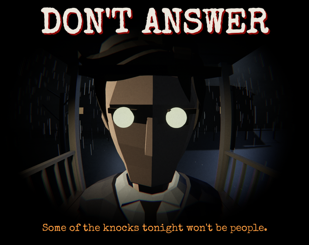

# Don't Answer

**Some of the knocks tonight won't be people.** A first-person horror game made for the GameDev.tv Halloween Jam 2026 (theme: *Uninvited*).

## About

One year ago your little brother Leo vanished on Halloween night. Tonight you wait for him in the same apartment. From midnight until sunrise, people knock. Some are real. Some are **the Uninvited**, things wearing familiar faces that never get them quite right.

- Check the peephole, the shadow under the porch light and the breath in the cold air
- Visitor roles change every playthrough, and every visitor has tells
- The rules change at 2 AM and 4 AM
- Lock doors and latch windows as they try to get in
- Fully voiced characters
- Four endings

**Controls:** WASD move · Mouse look · E / Click interact · F light · Tab phone · N rules

## Built with

Unity 6.5 · C# · Universal Render Pipeline · WebGL

Voice lines were generated with local text-to-speech tools (Kokoro, Chatterbox) and processed with Python scripts in `Tools/`.

## Links

- [Play it in your browser on itch.io](https://mrideedy.itch.io/dont-answer)
- [Jam entry](https://itch.io/jam/gamedevtv-halloween-jam-2026/rate/5138524)

## My role

Built with AI-assisted development for a game jam. I designed the game and directed, tested and submitted it.
